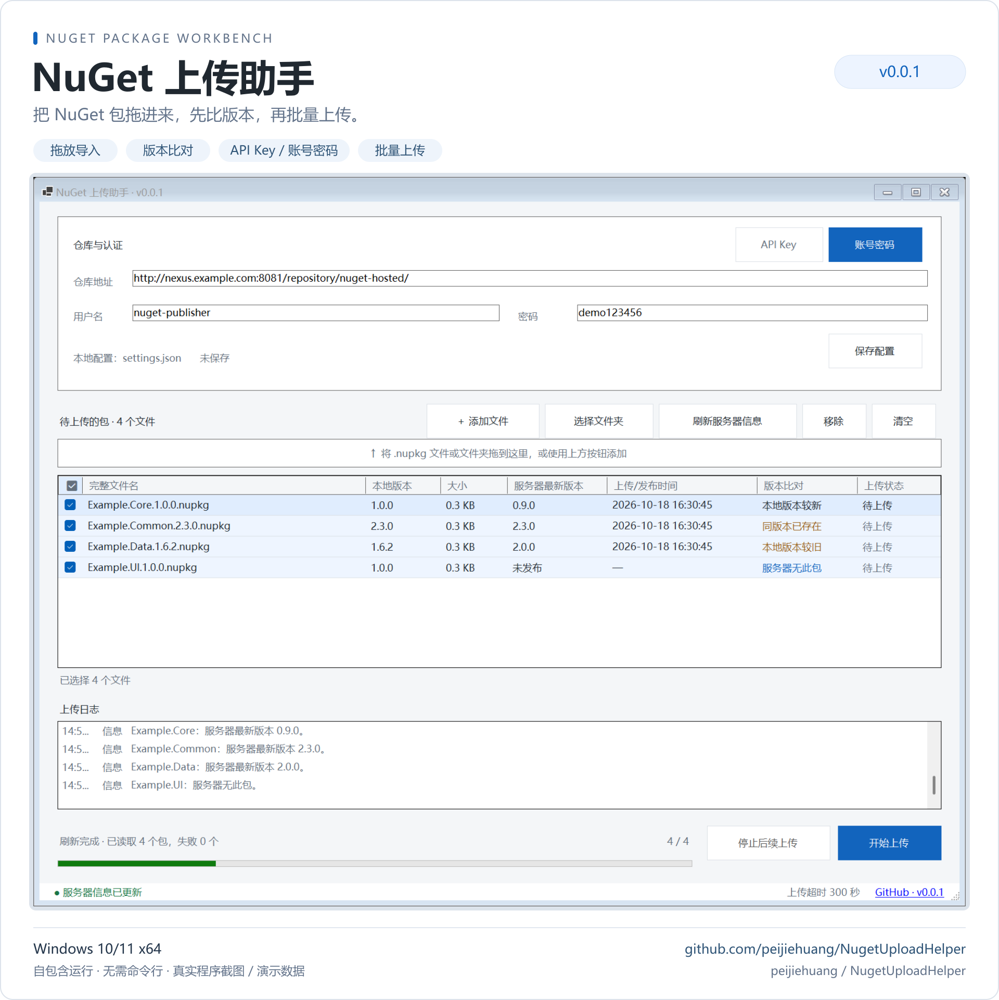

# NugetUploadHelper · NuGet 上传助手 `v0.0.1`

把 NuGet 包拖进来，先比版本，再批量上传。

面向 Windows 的中文桌面工具，适合向 Nexus 等 NuGet 仓库发布本地包。无需命令行，仓库配置、服务器版本比对、批量上传与日志集中在一个窗口中完成。

[](https://github.com/peijiehuang/NugetUploadHelper/releases)


项目主页：[GitHub · peijiehuang/NugetUploadHelper](https://github.com/peijiehuang/NugetUploadHelper) · [下载 Releases](https://github.com/peijiehuang/NugetUploadHelper/releases) · [问题反馈](https://github.com/peijiehuang/NugetUploadHelper/issues)



> 海报基于真实 WinForms 窗口截图制作，使用演示凭据、测试包和模拟服务器元数据；不代表连接了真实业务仓库。[查看原始界面截图](assets/screenshots/workbench.png) · [查看上传完成截图](assets/screenshots/uploaded.png)

## 核心功能

- **轻松导入**：添加文件、选择文件夹或拖放 `.nupkg`，读取包内部 ID 与版本，按完整路径去重。
- **两种认证**：API Key 或账号密码，按选中的方式独立发送凭据。
- **先比版本**：查询服务器最新版本、上传/发布时间，区分本地较新、较旧、同版本已存在与服务器无此包。
- **批量上传**：勾选、全选、串行上传、进度反馈；失败后继续处理后续包。
- **随时掌握状态**：实时日志、失败详情、停止后续上传，以及当前包完成后关闭。
- **本地配置**：保存仓库、认证方式、凭据与最近目录；支持窗口缩放及高 DPI。
- **项目入口**：标题栏显示版本，状态栏可直接打开 GitHub 项目主页。

程序使用 .NET 10、WinForms 与 NuGet SDK，直接推送包，不依赖 `nuget.exe` 或本机 `dotnet` 命令。

## 下载与运行

在 [Releases](https://github.com/peijiehuang/NugetUploadHelper/releases) 下载：

| 文件 | 用途 |
| --- | --- |
| `NugetUploadHelper-v0.0.1-win-x64.exe` | 自包含单文件，放到可写目录后直接运行 |
| `NugetUploadHelper-v0.0.1-win-x64.zip` | 程序、使用说明和更新记录 |
| `NugetUploadHelper-v0.0.1-win-x64-SHA256SUMS.txt` | 发布文件的 SHA-256 校验值 |

运行环境：Windows 10/11 x64，无需另装 .NET SDK 或运行时。首次发布完成后，Releases 才会提供对应附件。

## 快速开始

1. 输入仓库地址，选择 **API Key** 或 **账号密码** 并填写对应凭据。
2. 添加或拖入普通 `.nupkg`，点击 **刷新服务器信息** 查看远端版本。
3. 勾选需要上传的包，点击 **开始上传**，在日志中查看结果。
4. 需要记住配置时点击 **保存配置**；需要停止时点击 **停止后续上传**，等待当前包完成。

**配置与密码以明文保存在程序目录的 `settings.json`，账号密码模式下密码也以明文显示。** 请妥善保管配置；提交 Issue 时去除凭据和业务信息。Git 默认忽略本地配置和包文件。

支持 HTTP/HTTPS NuGet V2 地址及 V3 `index.json` 地址，仅上传普通包，不发布符号包。文件夹导入只扫描顶层。重复版本是否允许由仓库决定；超时后重试前应先核对服务器状态。

完整操作、认证与版本比对规则见 [使用说明](docs/usage.md)。

## 源码与验证

在 Windows 上安装 .NET 10 SDK，打开 `NugetUploadHelper.slnx`，或在根目录执行：

```powershell
dotnet build NugetUploadHelper.slnx -c Release
dotnet test NugetUploadHelper.slnx -c Release
./scripts/publish.ps1
```

发布脚本默认先运行测试，再生成自包含单文件、ZIP 和校验值，结果位于 `artifacts/release/`。临时发布目录使用唯一名称，ZIP 只打包指定程序与说明，避免夹带本地配置。构建从仓库 `NuGet.Config` 中配置的 nuget.org 恢复依赖，不修改本机 NuGet 配置。

| 目录 / 文件 | 用途 |
| --- | --- |
| `src/NugetUploadHelper/` | WinForms 界面、上传、版本比对、包读取与配置存储 |
| `tests/NugetUploadHelper.Tests/` | 行为测试、本地 HTTP 集成测试与真实窗体烟测 |
| `assets/` | README 海报及演示界面截图，随源码提交 |
| `docs/usage.md` | 完整使用说明与功能边界 |
| `scripts/publish.ps1` | 测试、发布和打包 |
| `.github/workflows/` | Windows 构建检查与标签发布 |
| `Directory.Build.props` | 统一版本号及项目元数据 |
| `artifacts/` | 本地截图与发布产物，不提交 Git |

测试在本地 HTTP 服务和演示数据上验证行为，不需要真实 Nexus。窗体烟测会生成 `artifacts/ui/workbench.png` 和 `uploaded.png`；真实 Nexus 的权限、认证和服务端策略仍需在目标环境验证。

### 在编辑器中预览界面

在 Visual Studio 中双击 `src/NugetUploadHelper/MainForm.cs`，或选中该文件按 **Shift+F7**，即可打开 Windows 窗体设计器，无需启动程序。可直接选择控件、调整布局和编辑属性。

窗体只保留一套标准设计器文件：`MainForm.cs` 集中管理交互，`MainForm.Designer.cs` 保存控件、布局与表格列，`MainForm.resx` 保存设计器资源。设计视图同时展示 API Key 和账号密码输入区，便于修改；运行时根据认证方式显示对应输入区。无参构造仅创建界面，不读取本地配置、不连接仓库。

## 版本与发布

版本统一维护在 `Directory.Build.props`：产品版本 `0.0.1`，程序集和文件版本 `0.0.1.0`，界面显示 `v0.0.1`。

推送 `main` / `master` 或提交 Pull Request 时执行构建检查；推送 `v*` 标签时，[发布工作流](.github/workflows/release.yml) 校验标签与版本、运行测试、构建并创建 GitHub Release。手动触发工作流仅验证和打包，不创建 Release。

准备好提交和发布后，再推送与源码版本一致的标签。更新内容见 [CHANGELOG.md](CHANGELOG.md)。
